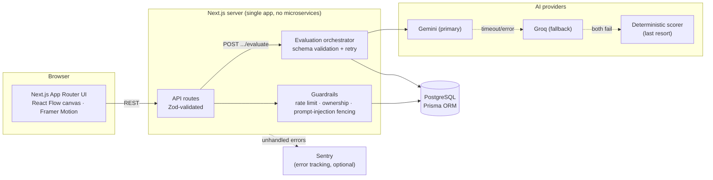

# Architect — System Design Studio

Design systems on a real drag-and-drop canvas, commit to real capacity numbers before grading, and get AI-scored feedback across completeness, scalability, reliability, security, and cost — like a staff engineer reviewed your whiteboard.

Built as a standalone portfolio project — not a tutorial clone. The interesting parts are the AI evaluation pipeline (multi-provider fallback, schema-validated output, retry-on-malformed-response, prompt-injection guarding) and the guardrails around it (per-user rate limiting, cost/usage ledger, ownership checks on every mutation), not the CRUD scaffolding.

## Why this exists

Most "system design practice" tools either grade nothing (just a whiteboard) or grade everything with a single unaccountable LLM call. This does neither:

- **Capacity checkpoint** — before grading, you commit to real numbers (expected QPS, read:write ratio, data volume). The evaluation prompt cross-checks your diagram against *your own numbers*, not a generic rubric. Claim 50,000 QPS with no cache or load balancer in the diagram, and it says so specifically.
- **Two independent AI providers** — Gemini is primary, Groq is an automatic fallback if Gemini errors out or times out, and a deterministic rule-based scorer is the last resort if both fail. A provider outage degrades quality, not availability.

## Screenshots

*(Add screenshots/GIF here once you have them — dashboard, canvas editor mid-drag, and the evaluation panel with the score animation are the three worth showing.)*

## Architecture



**Request flow for a graded submission:** client submits diagram + capacity numbers → API validates input (Zod) and checks ownership → rate limiter checks the user hasn't exceeded their hourly evaluation quota (DB-backed sliding window) → prompt is built with user content fenced against prompt injection → Gemini is called (retried once); on failure, Groq is called as a second, independent provider → the response is parsed and validated against a strict schema; a malformed response triggers one full retry before falling back to the deterministic scorer → the result and a cost/token usage record are persisted → response returned to the client.

## Tech stack

| Layer | Choice |
|---|---|
| Framework | Next.js 16 (App Router, Turbopack) + TypeScript + React 19 |
| Styling | Tailwind CSS v4, custom design-token system (dark-default, light toggle via `next-themes`) |
| Animation | Framer Motion |
| Database | PostgreSQL + Prisma ORM |
| Auth | Auth.js v5 — credentials (bcrypt) + GitHub OAuth |
| Canvas | React Flow (`@xyflow/react`) |
| AI | Google Gemini (primary), Groq (fallback), Zod-validated structured output |
| Testing | Vitest |
| CI | GitHub Actions (lint, typecheck, test) |
| Error tracking | Sentry (`@sentry/nextjs`), optional — inert without a DSN |
| Icons | lucide-react |

## Guardrails, security, and governance

- **Rate limiting** — per-user hourly cap on AI evaluation calls (`EvaluationLog`-backed sliding window), enforced *before* the expensive LLM call, not after.
- **Prompt-injection defense** — every piece of user-controlled text (node labels, edge labels, capacity notes) is delimiter-fenced in the evaluation prompt with an explicit instruction that fenced content is data, never a command. The delimiter is stripped from user input first so it can't be used to forge an early fence close.
- **Schema-validated AI output** — the model's JSON is parsed through a strict Zod schema before it ever reaches the client or the database. A response that doesn't validate triggers one retry (a fresh generation, not a repeat of the same broken output); if that also fails, a deterministic fallback scorer runs instead.
- **Ownership checks** — every mutating route re-verifies the requesting user owns the resource server-side; a public design page is a *separate* read-only query path scoped to `isPublic: true`, not the same query gated by a client-supplied flag.
- **Cost/usage governance** — every AI call (success, fallback, or failure) is logged with token counts and an estimated cost, surfaced on the Account page.
- **Real account deletion** — cascades through the schema (`onDelete: Cascade`), not a soft "deactivated" flag.
- **AI disclosure** — scored results are explicitly labeled as a review aid, not an authoritative assessment.

## Getting started

Requires Docker (for local Postgres) and Node 20+.

```bash
git clone <this-repo>
cd system-design-studio
npm install
cp .env.example .env   # fill in DATABASE_URL, AUTH_SECRET, GEMINI_API_KEY, GROQ_API_KEY

# start Postgres in Docker
docker run --name sds-postgres -e POSTGRES_PASSWORD=devpass -e POSTGRES_DB=system_design_studio -p 5434:5432 -d postgres:16

npm run db:migrate
npm run db:seed
npm run dev
```

Open http://localhost:3000. GitHub login is optional — email/password works standalone.

On subsequent runs, just `docker start sds-postgres && npm run dev` (the container doesn't auto-start with Docker Desktop).

### Scripts

| Command | What it does |
|---|---|
| `npm run dev` | Start the dev server |
| `npm run build` | Production build |
| `npm test` | Run the test suite (Vitest) |
| `npm run lint` | ESLint |
| `npm run typecheck` | `tsc --noEmit` |
| `npm run db:studio` | Prisma Studio — GUI to browse/edit the DB |

## What was deliberately cut, and why

This started as a much bigger plan — real-time collaborative editing (Yjs/CRDT), a community layer (browse/fork/comment on public designs), an AI interview-simulator bot, gamification/leaderboards, a worker+queue architecture for async evaluation. All of it was cut, not deferred to a vague "phase 2":

- **Real-time collab** — the single highest-effort feature for the lowest probability a solo portfolio project needs it. Worth mentioning in an interview as a considered trade-off, not worth building for an audience of one.
- **Community/social features** — would require moderation, pagination-at-scale, and abuse handling for a feature with no actual users yet. Premature.
- **Async job queue (Redis/BullMQ) for evaluation** — the "correct" architecture for a high-traffic product, but synchronous evaluation in the API route is simpler, has fewer moving parts to run locally, and is completely adequate at this scale. This is the trade-off most worth defending in an interview: I know what the "more scalable" version looks like and chose not to build it because the actual load doesn't justify the complexity yet.
- **Interview-simulator bot, gamification** — pure feature scope-creep relative to what the AI-grading core actually needed to prove.

The point of cutting these explicitly (rather than silently not building them) is that "I know what I didn't build and why" is a stronger signal than a longer feature list.

## Known limitations

- Evaluation latency varies (roughly 10–80s) since it can involve multiple provider retries — there's no async/websocket pattern to make this feel instant, by design (see above).
- AI provider pricing constants (`src/lib/ai/client.ts`) are estimates for the internal cost ledger, not verified against live billing pages.
- No deployment is live by default — see `.env.example` for what a host (Vercel + Neon, or similar) needs.
